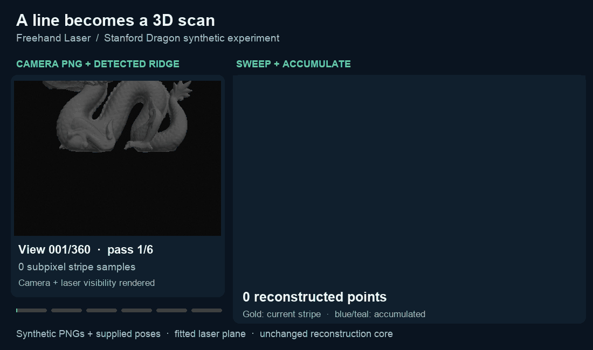

# Freehand Laser Scanning Using Mobile Phone

A smartphone and a cheap line laser become a handheld 3D scanner. With the laser rigidly attached, find its stripe, intersect camera rays with the calibrated laser plane, then combine points using the phone’s pose.

**Ron Slossberg, Aaron Wetzler and Ron Kimmel · BMVC 2015**

[Paper](https://www.bmva-archive.org.uk/bmvc/2015/papers/paper088/paper088.pdf) · [DOI](https://doi.org/10.5244/C.29.88) · [Original demonstration](https://www.youtube.com/watch?v=_Nr1Jh4NsFs)



**360 camera views → 36,560 reconstructed points.** This synthetic Stanford Dragon experiment runs generated 320×240 PNGs through stripe extraction, board calibration and triangulation. Poses are supplied. The cloud covers **88.2% of the source surface within 5 mm**, by area-weighted sampling. Gold marks the current stripe; the final orbit changes only the display viewpoint. [Data, scoring limits and reproduction](showcase/README.md).

## How it works

1. **Find the stripe.** Paired Gaussian-derivative filters at several scales and orientations detect bright ridges. A five-sample cubic fit refines each center to subpixel precision.
2. **Recover depth.** Observations of a flat calibration board determine the laser plane relative to the camera. A detected pixel’s camera ray intersects that plane at a 3D point.
3. **Combine views.** Camera poses place each new line into the same world frame. The paper’s system also obtains surface color by reprojecting points into earlier images, before the laser illuminated them.

## Try it

Python 3.12+; run from the repository root:

```sh
python3 -m venv .venv
.venv/bin/pip install -r updated/requirements.txt
.venv/bin/python -m showcase.checks
```

This reprocesses 32 included calibration/scan PNGs and verifies their points against the published cloud. The [showcase guide](showcase/README.md) regenerates all 360 observations and the animation. Results retain occlusion gaps and silhouette outliers, with separate surface-distance and camera-ray correspondence scores.

The [adapter guide](updated/README.md) covers the tested unsigned iOS replay app and smaller plane/sphere/fold regression cases, including a deliberately failing bright distractor. The app computes from source PNGs and poses. Supplied poses and ideal synthetic camera geometry limit these experiments; they do not measure hardware accuracy or reproduce live tracking.

The **paper’s separate experiments** report 4.48 and 2.25 mm RMSE for two front-side scans, after ICP alignment to reference models, using an iPhone 5s at roughly one metre and 720p. The original capture app depends on SDK components and resources excluded or missing here; live scanning and the paper’s benchmarks have not been reproduced here.

## Explore

- [Dragon experiment: observations, all points, PLY and metrics](showcase/README.md)
- [Runnable stages, iOS replay and regression cases](updated/README.md)
- [Original MATLAB experiments](matlab/experiments/) and [iOS implementation](ios/Scanner/)
- [Source history/provenance](docs/PROVENANCE.md), [build limits](docs/DEPENDENCIES.md) and [validation](docs/VALIDATION.md)

Licensing is per component: new software is MIT; the Dragon and derived observations, clouds and media retain [Stanford’s research-use terms](showcase/STANFORD-ASSET-TERMS.md). Historical code keeps its original notices. See [NOTICE](NOTICE.md).

```bibtex
@inproceedings{Slossberg2015Freehand,
  author = {Ron Slossberg and Aaron Wetzler and Ron Kimmel},
  title = {Freehand Laser Scanning Using Mobile Phone},
  booktitle = {Proceedings of the British Machine Vision Conference},
  year = {2015},
  pages = {88.1--88.10},
  doi = {10.5244/C.29.88}
}
```
