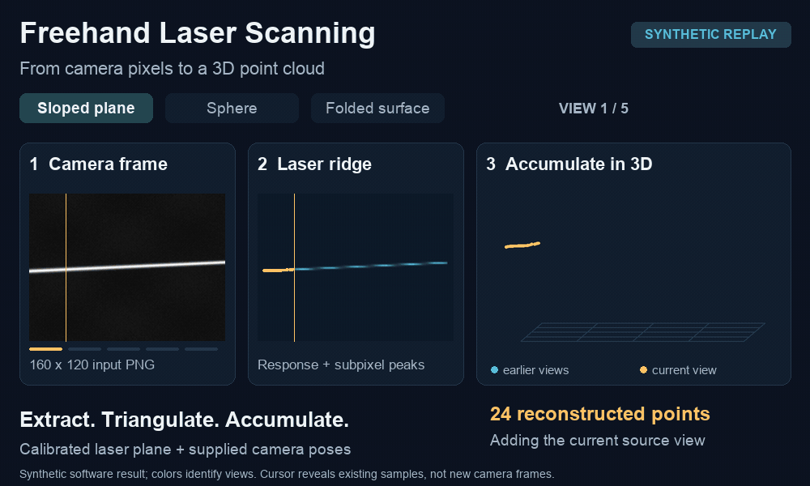

# From camera frames to a point cloud



This 12-second loop presents **existing synthetic inputs and computed reconstruction output** from the runnable adapter. It cycles through a sloped plane, sphere and folded surface. Each scene reveals the detections from five source views, adds their 3D points, then orbits the completed point cloud. It is an explanatory visualization, not footage from the original phone or a new hardware experiment.

- The left panel is the actual 160×120 fixture PNG, enlarged for viewing.
- The middle panel is the adapted filter response with the actual subpixel peak coordinates overlaid.
- The right panel contains the actual stored reconstructed XYZ samples. It adds only points revealed in the current source view; it does not interpolate new 3D positions or draw a reconstructed mesh.
- Gold identifies the current source view; teal identifies earlier views. These are display colors, not recovered surface texture.
- A cursor progressively reveals columns in an existing image. It does not represent a camera frame rate or a measured processing speed.
- The final orbit is an orthographic display transform. Exported coordinates are unchanged. The faint grid is a display reference, not estimated surface geometry.
- Full-scene surface RMSE appears only after all five source views have been accumulated. These are synthetic adapter results; the paper’s separate hardware measurements are discussed in the main README.

Camera poses are supplied. The laser plane was estimated from the six committed calibration images by the numerical workflow; the renderer reads its existing scan outputs. Noise and the three source occlusion frames are preserved, including missing detections. The [model and limitations](../updated/README.md) explain the adapted kernels, calibration, image formation and deliberate failure cases.

## Rebuild

From the repository root, with the dependencies in `updated/requirements.txt` installed and FFmpeg on PATH:

```sh
python scripts/render_demo.py --scratch /tmp/freehand-laser-media
```

The command writes the GIF, poster, per-frame provenance and validation report to `media/`. Its scratch directory contains 150 bounded RGB frames, the palette, a contact sheet and selected decoded GIF frames. Use `--output <path>` for a comparison run. Keep scratch outside the repository. No account or network access is required.

The renderer uses installed Arial fonts on macOS, or DejaVu Sans on Linux. For exact font selection, pass `--font-regular <font.ttf> --font-bold <font.ttf>`. Fonts are not redistributed; their file hashes and the tested Python/NumPy/SciPy/Pillow/FFmpeg versions are recorded. Exact GIF bytes depend on that rendering environment.

## Evidence and scope

[validation.json](validation.json) records logical source paths and SHA-256, fixture-image hashes, renderer and font hashes, every decoded RGB frame hash, duration, dimensions, loop and size checks. [frame-provenance.json](frame-provenance.json) records each frame’s source image, reveal cutoff, exact displayed point count and orbit angle. These media checks are separate from the numerical test records; rendering the GIF does not rerun or extend the historical app, native simulator or numerical validation.

[review.json](review.json) records contact-sheet/decoded-frame inspection and deterministic reproduction. The [poster](freehand-laser-poster.png) is decoded from the GIF at the completed sphere view. The animation is 1000×600, 150 frames at 80 ms each, loops indefinitely and is approximately 1.21 MB.

The full BMVC 2015 report informed the explanation; no report figures, real capture photographs or original demonstration frames are incorporated. All pictured images and 3D points come from this repository’s new synthetic workflow. New visualization code and assets have a [scoped MIT license](LICENSE); the source fixture/adapter license and 13th Lab attribution remain in [updated/LICENSE](../updated/LICENSE).
