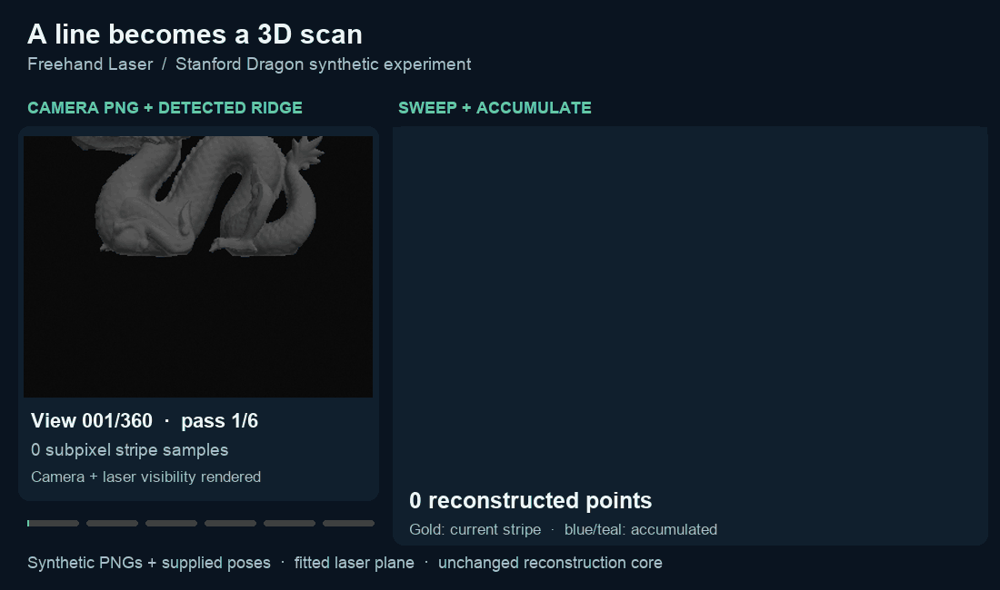

# Scanning a complex object, one laser stripe at a time

The camera and line laser form a rigid rig. Moving that rig vertically sweeps
the stripe across a surface; viewing from six directions fills in different
parts. This experiment reconstructs a recognizable, detailed object through
the same runnable filter, subpixel, calibration and triangulation stages used
by the smaller regression cases.



**360 generated camera PNGs → 36,560 accepted 3D points.** Camera poses are
supplied explicitly. The source scene is Stanford’s measured Dragon mesh,
uniformly scaled to 0.35 m tall. These are synthetic observations, not a scan
of the physical statuette or a reproduction of the paper’s hardware results.
Stanford University Computer Graphics Laboratory supplies the source asset;
its [separate research-use terms](STANFORD-ASSET-TERMS.md) cover the derived
images, clouds and animation.

## What is actually computed

1. **Calibrate from images.** Eight independently generated flat-board PNGs
   yield 2,451 observed board points. Their fitted camera-frame laser plane
   is used for reconstruction; the true plane is not substituted.
2. **Generate camera observations.** A CPU first-hit ray caster renders the
   complete 871,414-triangle mesh at 320×240. The attached emitter lights a
   finite-width stripe with seeded sensor noise. Camera visibility and
   emitter-to-surface shadows are evaluated separately.
3. **Extract and reconstruct.** Unchanged [updated/laser.py](../updated/laser.py)
   runs its paired multiscale filters, strongest ridge per column, cubic
   subpixel refinement, ray/estimated-plane intersection and supplied-pose
   transformation. It receives PNG pixels, intrinsics, fitted plane and pose;
   no mesh vertices, depth map, face IDs or visibility mask enter the inverse.

There are 60 vertical positions per direction, 6.61 mm apart, at a 0.72 m
camera radius. Alternate passes point 20° downward; the others are horizontal.
The emitter is 10 cm below the optical center and rigidly shares its camera
frame. The stripe’s Gaussian cross-section has 2.2 mm standard deviation.
Full rig settings and every pose are in [configuration](data/configuration.json)
and [metrics](data/metrics.json). The simple shading/noise model, exact poses,
ideal pinhole camera and fixed scale do not model real tracking or optics.

## Results and their limits

All **36,560** accepted points remain in the NPZ and full PLY, including
silhouette errors. Truth is used only for scoring. No surface-distance
filter, meshing, smoothing or hole filling changes the output.

| Measure | Result | Meaning |
|---|---:|---|
| Entire-mesh coverage within 5 mm | **88.23%** | Fraction of 50,000 deterministic, triangle-area-weighted mesh samples near a scan point |
| Entire-mesh coverage within 10 mm | 95.03% | Same sampling, including hidden undersides |
| Nearest-surface RMSE | **1.50 mm** | Unsigned point-to-mesh distance for every accepted point; not correspondence accuracy |
| Same-ray first-surface RMSE | **8.90 mm** | Euclidean error against the mesh’s first hit at the predicted subpixel ray, for 35,027 finite correspondences |
| Same-ray median / 95th percentile / maximum | 1.12 / 5.24 / 227.90 mm | Large silhouette/finite-stripe outliers remain visible in the statistics |
| Accepted rays without a mesh first hit | **1,533** | Included in nearest-surface scoring, separately counted rather than assigned a fabricated correspondence |
| Calibration normal / offset error | 0.0064° / 0.096 mm | Compared with the independent forward rig truth |

A point can lie close to the surface while corresponding to the wrong part
along its ray. Finite stripe width, discretized images and silhouette peaks
explain why the two error measures differ. The one-peak-per-column policy
also misses some overlapping branches. Occluded areas, the underside and
documented holes in Stanford’s source mesh remain limitations. These numbers
are a bounded synthetic experiment, not scanner accuracy specifications.

The animation samples 96 stages of the actual 360-view sequence and retains
all points accumulated up to each stage. Gold dots are the current view’s
computed stripe; blue/teal height colors are display attributes, not recovered
texture. The final 48 frames orbit the complete cloud beside a labelled
example capture. Playback speed is illustrative, not sensor FPS. A fixed
centered view keeps the sculpture recognizable; per-frame display clipping
counts are recorded in [media evidence](validation/media.json).

## Use the included data

With the ordinary adapter dependencies, from the repository root:

```sh
python -m showcase.checks
```

This verifies file hashes, refits the plane from all eight board PNGs and
reprocesses 24 selected scan PNGs from all six directions. Their UV and XYZ
match the corresponding stored points exactly on the recorded environment.
It also verifies that the full PLY contains every point.

- [reconstruction.npz](data/reconstruction.npz): all XYZ, subpixel UV, view IDs,
  360 supplied camera-to-world poses and the fitted laser plane.
- [reconstruction.ply](data/reconstruction.ply): every accepted point, with
  display colors; [preview.ply](data/preview.ply) keeps every third point.
- [Selected captures](data/captures/) and [all calibration PNGs](data/calibration/).
- [Manifest](data/manifest.json), [full metrics](data/metrics.json),
  [public-subset replay](validation/replay.json) and
  [all-360-view replay](validation/full-replay.json).

Coordinates use metres, world +Y up and camera +X right/+Y down/+Z forward.
The package contains computed scan points, not a reconstructed triangle mesh.

## Regenerate the complete experiment

Use Python 3.12 and a native-filesystem virtual environment. The recorded
run used NumPy 2.0.2, SciPy 1.14.1, Open3D 0.18.0 and Pillow 10.4.0. Read
Stanford’s terms before explicitly downloading its approximately 11 MB
archive. The checksum-pinned recipe reads only the selected mesh and README;
it applies uniform scale/translation without decimation or repair.

```sh
pip install -r showcase/requirements.txt
python -m showcase.prepare_mesh --download --output showcase/assets
python -m showcase.generate --cache /path/to/scan --passes 6
python -m showcase.checks --cache /path/to/scan --output /path/to/full-replay.json
python -m showcase.export --cache /path/to/scan --output /path/to/public-data
python -m showcase.render --cache /path/to/scan --scratch /path/to/media-frames --output /path/to/media
```

FFmpeg is required for the last command. Every generation run creates fresh
PNGs and reprocesses them; cached UV/XYZ are never trusted as inputs. Use a
task-scoped cache with room for all 360 PNGs and intermediate observations.
The large source mesh and full capture cache are not bundled in Git. Their
checksums, every capture hash and exact normalization are recorded in
[mesh provenance](assets/mesh-provenance.json) and the data metrics.

The separate [first-hit checks](validation/forward.json) compare 32 rays with
an exhaustive float64 triangle reference and test known geometry, ray scale,
clipping and shadows. Run `python -m showcase.validate_mesh_scene` after
fetching the mesh. They validate forward geometry, not hardware. GIF source,
font and every decoded-frame hash, timing and input bindings are recorded
separately from the unchanged [adapter/native validation](../updated/validation/).

The new [showcase software is MIT](LICENSE), with the shared helper’s
[notice](HELPER-LICENSE) retained. Stanford asset terms remain separate.
The earlier [plane/sphere/fold animation](../media/README.md) and
[regression cases](../updated/README.md) are useful small tests, rather than
the main complex-object demonstration.
