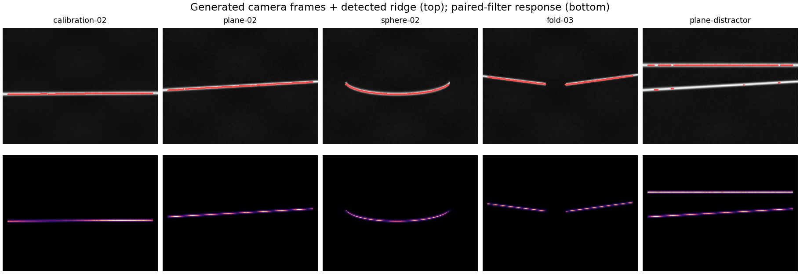
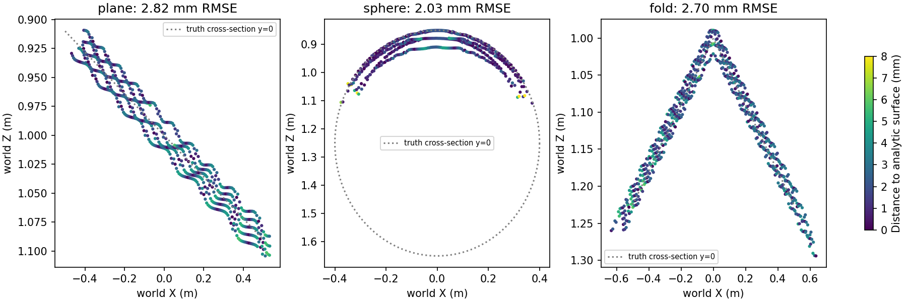
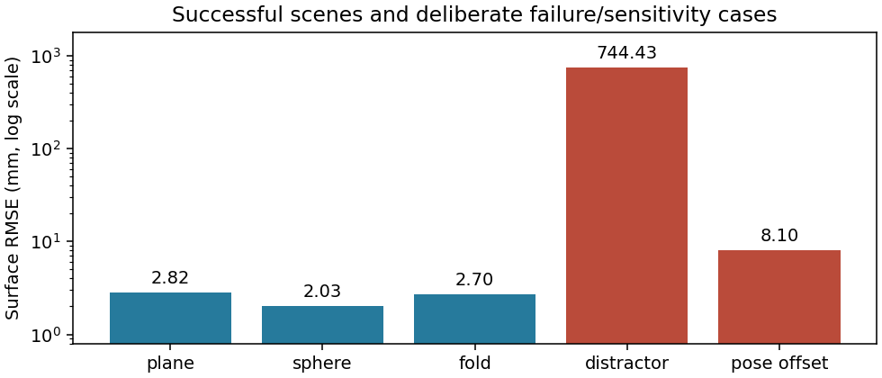

# Runnable Freehand Laser stages

This adapter executes the recovered method’s central stages: paired multiscale laser-line filtering, subpixel peak fitting, camera-attached laser-plane calibration, and ray/plane triangulation into world coordinates. The Python implementation and Accelerate C implementation run on independently generated images with known geometry. An unsigned iOS simulator app executes the C implementation on those same PNGs.

**This is an adapted test application, not the historical iOS app.** Camera poses and a metric calibration board are supplied by the simulator. The historical proprietary PointCloud tracker, live capture, distortion model, texture/color registration and hardware integration are not implemented here. The [historical unsigned build attempt](../docs/BUILD_ATTEMPT_2026-11-15.md) records why that app remains blocked.

## Run on desktop

From the repository root, use Python 3.12 or newer in a native-filesystem environment:

```sh
python3 -m venv .venv
.venv/bin/pip install -r updated/requirements.txt
.venv/bin/python -m updated.run_simulation
.venv/bin/python -m updated.run_checks
```

`run_checks` compiles the same C core used by the app with macOS Accelerate, executes numerical comparisons and an AddressSanitizer/UndefinedBehaviorSanitizer harness. On Linux use `--python-only`; this explicitly skips native and sanitizer checks. No SDK, training, account, network service or model is used at runtime.

`run_simulation` deterministically regenerates the 22 PNGs and metadata in [fixtures/](fixtures/), then writes [artifacts/](artifacts/): metrics JSON, per-frame detected pixels/3D points, an ASCII [PLY](artifacts/reconstruction.ply), frame/filter montage, geometry plots and an error chart. Colors in the PLY identify views; they are not recovered texture. The combined PLY contains the three successful scenes in one coordinate system; `plane.ply`, `sphere.ply` and `fold.ply` provide individual clouds. Use `--fixtures <path> --output <path>` to direct regenerated data elsewhere. `--no-plots` omits plotting only.



## What is reused, and what changed

| Stage | Recovered evidence | Adapter behavior |
| --- | --- | --- |
| Contrast | iOS `gammaCorrection`, `PointCloudApplication.mm` | Gamma 12 on grayscale PNG intensities. This is not the historical BGRA weighted conversion or the paper’s red-channel preprocessing. |
| Paired filters | iOS `convFilter`, lines 181–275; paper §2.1 | Same positive-response minimum within a pair, maximum across 4 scales × 3 orientations; same native vImage/vDSP operations. Newly sampled, centered 11×11 shifted Gaussian derivatives, L1 normalized. |
| Ridge location | Original MATLAB extraction/paper and iOS five-sample cubic fit | One vertical subpixel maximum per image column, five-sample cubic least squares; ±0.7 px bound from iOS. Explicit quadratic-limit fallback, response threshold 8 and five-pixel border guard. Portrait column convention is explicit, rather than a byte-for-byte port of the historical landscape/x-neighbor loop. |
| Calibration | `HardwareController.mm` and `findRealWorldPoint` | Rays intersect a known world board; points remain in camera coordinates. Multiple moving rig views fit the camera-attached plane with centered homogeneous SVD. Reject near-collinear clouds (second/first spatial singular-value ratio <1%). General board equation replaces hardcoded world y=0. |
| Reconstruction | `findRealWorldPointLaser`, lines 326–349; MATLAB counterpart | `q=K⁻¹[u,v,1]`, `alpha=-d/(n·q)`, then camera-to-world transform. Explicit K/rig validation, positive depth ≤3 m and ray/plane absolute cosine ≥0.03. |

The committed `kernels.h` is preserved. `bank='archived'` parses its literal C initializer semantics, including trailing zero fill; `metrics.json` includes a separately labelled diagnostic using it. All 24 selected `[121]` declarations contain 81 explicit values followed by 40 C zero-fill values; the three angle-labelled arrays are identical within each scale/side. The default rebuilt bank is therefore stated explicitly. Neither the archived diagnostic nor the rebuilt adapter claims exact historical image output. Threshold 8 is specific to the regenerated/L1-normalized grayscale bank; it is not the paper’s threshold 85 on its preprocessing.

Native arithmetic uses float image/filter buffers and double geometry; Python uses float64 filtering. Native cubic near-zero tolerance is `1e-7` relative to response scale, versus `1e-10` in Python, to handle float cancellation. Away from such boundaries the actual frame comparisons are tight; those tolerances do not promise identical decisions on every possible image.

The original iOS sparse calibration mask could contain uninitialized pixels; the recovered cubic fit also lacked a zero-leading-coefficient guard, and its frame-color buffers have unsafe indexing/timing paths. The adapter operates on initialized image buffers, tests degeneracies, and does not execute or claim to reproduce those unsafe integration paths. Original source bytes remain intact.

## Coordinates and synthetic experiment

Metadata uses zero-based pixel `(u,v)`, camera +X right/+Y down/+Z forward, metres, and row-major **camera-to-world** rigid 4×4 matrices. This differs from the recovered SDK’s transposed world-to-camera buffer representation. K is supplied per sequence; historical hardcoded phone intrinsics are not reused. The camera/laser rig moves rigidly; its laser plane is fixed in camera coordinates, not world coordinates.

Six 160×120 calibration views observe a known world board. Each grayscale image is generated by independently ray-casting an analytic surface, then illuminating surface hits by physical distance to the attached laser plane. Pixel noise uses a recorded seed. Fifteen scan views observe a sloped plane, sphere and folded surface; each scene has one laser-occlusion frame. A sixteenth scan adds a bright non-laser ridge. The detector receives PNGs, K and poses; truth surfaces and the true laser plane are used only for scoring. Calibration estimates its plane from PNG observations rather than copying ground truth.

[metrics.json](artifacts/metrics.json) separates perpendicular distance to the analytic surface from continuous curve correspondence. The latter independently solves the true laser/surface intersection in each image column; it reports row error, full Euclidean 3D error, visible-column recall within 1 px and accepted samples without visible truth. Curve errors include **every prediction with an available same-column truth**, including large errors; the 1 px condition is used only for precision/recall, never to trim error statistics. Accepted predictions lacking visible same-column truth remain counted separately, and all accepted points contribute to surface metrics. Surface distance alone can hide tangential displacement.

At this resolution, the default successful-scene surface RMSE is approximately 2–3 mm. That is a synthetic software result, not the BMVC experiment or real scanner accuracy. The bright distractor is accepted with roughly 744 mm surface RMSE: local filtering does not identify whether a bright ridge came from the laser. A one-frame pose mismatch raises surface RMSE from 2.81 to 8.10 mm; a 5% external metric-scale error (board and pose translations) raises it to 49.14 mm. Supplied pose/marker scale and timing are external assumptions. `accepted_per_interior_column` is a count divided by the 150 interior columns, not visible-laser recall.





## Run the iOS simulator application

Xcode 16.1 / iOS 18.1 simulator SDK was used. Build unsigned without selecting an Apple account:

```sh
xcodebuild -project updated/ios/FreehandReplay.xcodeproj \
  -scheme FreehandReplay -configuration Debug -sdk iphonesimulator \
  -destination 'generic/platform=iOS Simulator' -derivedDataPath /tmp/freehand-replay-build \
  CODE_SIGNING_ALLOWED=NO CODE_SIGNING_REQUIRED=NO CODE_SIGN_IDENTITY= DEVELOPMENT_TEAM= build
```

Install `Build/Products/Debug-iphonesimulator/FreehandReplay.app` on a task-owned booted simulator with `xcrun simctl install <UDID> <app-path>`, then `xcrun simctl launch <UDID> org.freehandlaser.Replay`. Coordinate the UDID when sharing a machine. No physical-device build or signing is claimed.

The app bundles only PNGs and sequence metadata. It extracts calibration ridges, fits its own plane, computes each scan’s ridge and point cloud through the compiled C core, and lets you select input frames and rotate an accumulated point cloud using the left/right/reset controls; a high-priority drag gesture is also implemented. The view centers and frames the current cloud using its bounds; rotation is a display transform and does not alter exported coordinates. The supplied camera poses are labelled in the UI; no tracker is simulated invisibly. The distractor has an explicit failure warning. It writes `Documents/native-validation.json` in its own app container, including the actual fitted plane and per-frame detected pixels and points, for comparison with [desktop-points.json](artifacts/desktop-points.json). Run `python -m updated.compare_native <exported-native-validation.json>` for the bounded numeric comparison. A precomputed PLY is never loaded by the app.

The app was installed and run on an iPhone 16 / iOS 18.1 simulator. [Actual simulator parity](validation/simulator-parity.json) passed for all 16 scan frames and 2094 points: maximum ridge-coordinate difference 1.74e-7 px and maximum world-coordinate difference 8.4e-9 m. This is numerical agreement on shared synthetic inputs, not physical measurement accuracy. [UI checks](validation/simulator-ui.json) verified frame selection, source-image/count updates, accumulation, the distractor warning, useful curved-cloud framing, fold occlusion, button rotation and reset. Drag is implemented but the automation tool did not demonstrate a visible rotation from its drag events; use the verified buttons. A terminate/relaunch check recreated the app’s generated validation file with the exact same SHA-256, then passed the numerical comparison again. No physical-device or real-laser operation was tested.

## Verification and scope

[validation/checks.json](validation/checks.json) records tested source hashes, package versions, fixture checks, native parity, sanitizer scope and fresh/stored metrics equality. The tests include known 3D transforms, negative/grazing/deep rays, bad/transposed/reflected/nonrigid poses, nonfinite input, malformed FFI buffer shapes, constant/border images, cubic degeneracy, collinear/noisy single-pose calibration, multi-pose calibration, occlusion, distractor failure and timing sensitivity. Generated PNG hashes are in `fixtures/sequence.json`.

MIT applies to this adapter and its generated assets under [LICENSE](LICENSE), retaining the 13th Lab sample-derived notice. Historical source elsewhere keeps its original individual license scope. This adapter does not import the proprietary SDK or separately restricted MATLAB helpers.
